# Awesome Qwen Image 3.0

English | [简体中文](./README.zh-CN.md) | [日本語](./README.ja.md)

> 👉 See also [Awesome Wan 3.0 Video](https://github.com/beatra-ai/awesome-wan-3-video)

Real Qwen Image 3.0 cases, with the full prompt on every card, ready to reproduce in your agent.

Every case below was generated on Beatra with this model; prompts are copied verbatim and each card names its task ID.

Reproduce it in your agent: `npx skills add beatra-ai/ai-image-generator-skill` · [beatra.ai](https://beatra.ai/?utm_source=github&utm_medium=cases_list&utm_campaign=awesome-qwen-image-3)

## Contents

- [Typography and posters](#typography-posters)
- [Product photos and scenes](#ecommerce)
- [Edits and backgrounds](#editing)
- [Several references, one picture](#multi-reference)
- [Illustration and style](#illustration)
- [Fictional portraits](#portraits)
- [Charts and diagrams](#infographics)

<a id="typography-posters"></a>

## Typography and posters

### 1. Brightmoss icon and wordmark

A flat Brightmoss wordmark lockup shows Qwen Image 3.0 Pro setting a short English name in a clean logo.

<p align="center">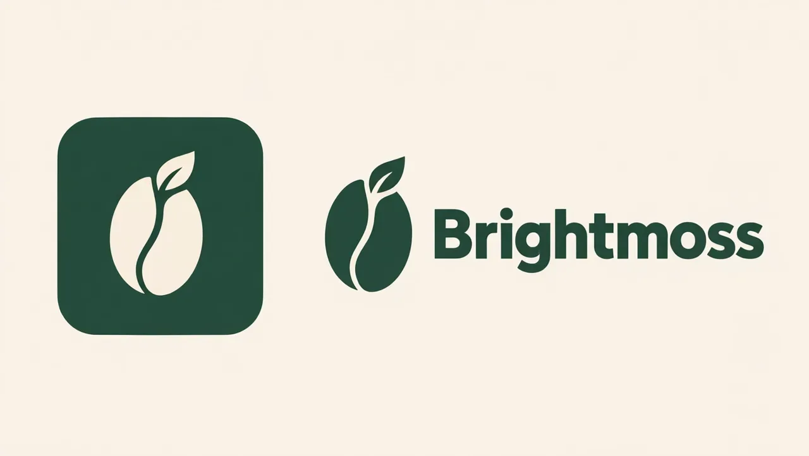</p>

*A flat cream board with a green icon and the word Brightmoss. AI-generated with Beatra.*

Ask your agent:

```text
Use Qwen Image 3.0 Pro to make a flat cream brand board: a forest-green app icon with the bean-and-leaf symbol, and the word Brightmoss beside it. Two colors, no other text.
```

Prompt:

```text
Refine this accepted Brightmoss logo into a two-part brand presentation on one flat warm cream background (#F4EEE2). Left: an app icon, a solid rounded square in deep forest green (#1F4D3A) with the same coffee-bean-and-leaf symbol from the image centered inside in cream, generous padding, no text in the icon. Right: a horizontal lockup, the same green bean-and-leaf symbol placed to the left of the exact word "Brightmoss" in the same bold humanist sans-serif lettering, forest green, vertically centered with the symbol. Keep the symbol shape and the wordmark letterforms identical to the source. Flat vector, maximum two colors, no gradients, no shadows, no mockup, no tagline, no other text.
```

Qwen Image 3.0 Pro · Text to image · 1280×723

Generated on Beatra · task task_mcp_33b755587a76a7bcb1bc5874324c2a4c9738a6fc

### 2. Northglass ferry poster

A cream ferry poster shows Qwen Image 3.0 setting English and Chinese type in the right place.

<p align="center">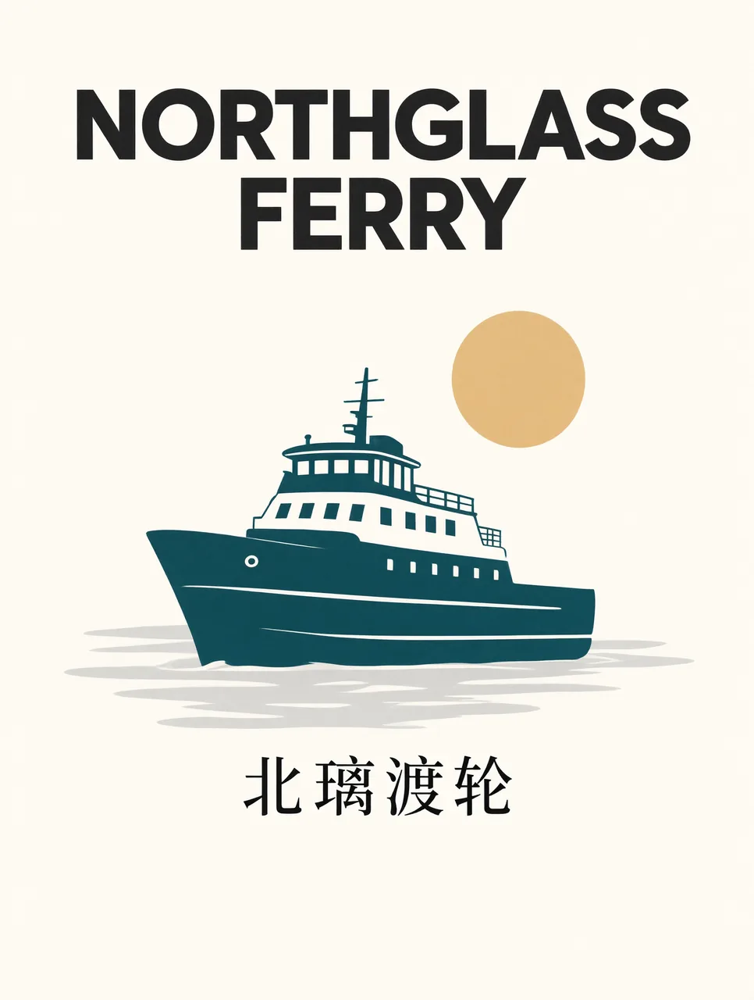</p>

*A cream poster with a dark teal ferry and the words NORTHGLASS, FERRY, and 北璃渡轮. AI-generated with Beatra.*

Ask your agent:

```text
Use Qwen Image 3.0 to make a vertical cream ferry poster: a dark teal boat, NORTHGLASS and FERRY at the top, and 北璃渡轮 under the boat. No other text.
```

Prompt:

```text
Vertical printed travel poster, cream paper, a simple flat illustration of a dark teal ferry on pale grey water under a wheat-colored sun, generous empty margin. Exact text only, perfectly spelled, no extra letters anywhere: NORTHGLASS in large bold black sans-serif at the top, FERRY directly under it in the same typeface, and the four Chinese characters 北璃渡轮 centered under the boat in a clean black serif. No dates, no logos, no watermark, no people.
```

Qwen Image 3.0 · Text to image · 2K · 3:4

Generated on Beatra · task task_mcp_3ae36b5a0a40614b79dc862d0bb0f47c7d703480

### 3. Hearthlane market poster

A wide market poster shows Qwen Image 3.0 rendering one English name and one Chinese line.

<p align="center">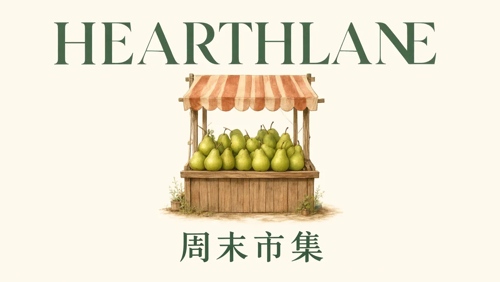</p>

*A wide cream poster with a fruit stall, the name HEARTHLANE, and 周末市集. AI-generated with Beatra.*

Ask your agent:

```text
Use Qwen Image 3.0 to make a wide cream market poster: a small fruit stall, HEARTHLANE across the top, and 周末市集 along the bottom. No other words.
```

Prompt:

```text
Wide market poster, warm cream background, a small centered illustration of a wooden stall with green pears and a rust-striped awning, lots of empty space. Exact text only, perfectly spelled: HEARTHLANE in large dark-green serif across the top, and the four Chinese characters 周末市集 centered at the bottom in the same dark green. No other words, numbers, logos, or watermarks.
```

Qwen Image 3.0 · Text to image · 2K · 16:9

Generated on Beatra · task task_mcp_ed1fe7fb9bb09b117ebce535beb68127861fa116

### 4. Lumen Orchard lantern poster

A navy concert poster shows Qwen Image 3.0 placing a bilingual title around a single lantern.

<p align="center">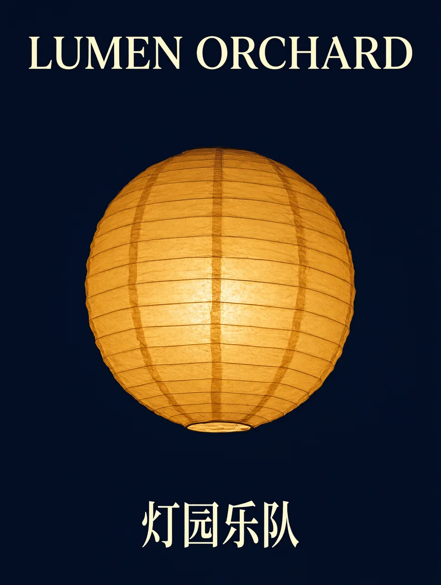</p>

*A navy poster with one amber lantern and the words LUMEN ORCHARD and 灯园乐队. AI-generated with Beatra.*

Ask your agent:

```text
Use Qwen Image 3.0 to make a navy concert poster with one amber paper lantern, LUMEN ORCHARD near the top, and 灯园乐队 under the lantern. No dates or other letters.
```

Prompt:

```text
Minimal concert poster, deep navy background, one round paper lantern glowing amber in the center. Exact text only, perfectly spelled: LUMEN ORCHARD in cream serif capitals near the top, and the four Chinese characters 灯园乐队 in cream under the lantern. No dates, no other letters, no logos, no watermark.
```

Qwen Image 3.0 · Text to image · 2K · 3:4

Generated on Beatra · task task_mcp_430d142962b0c29b18cb70ac2a6fa3f4a458317b

### 5. Paper Finch book-fair poster

A book-fair poster shows Qwen Image 3.0 spelling a three-line bilingual title around a line drawing.

<p align="center">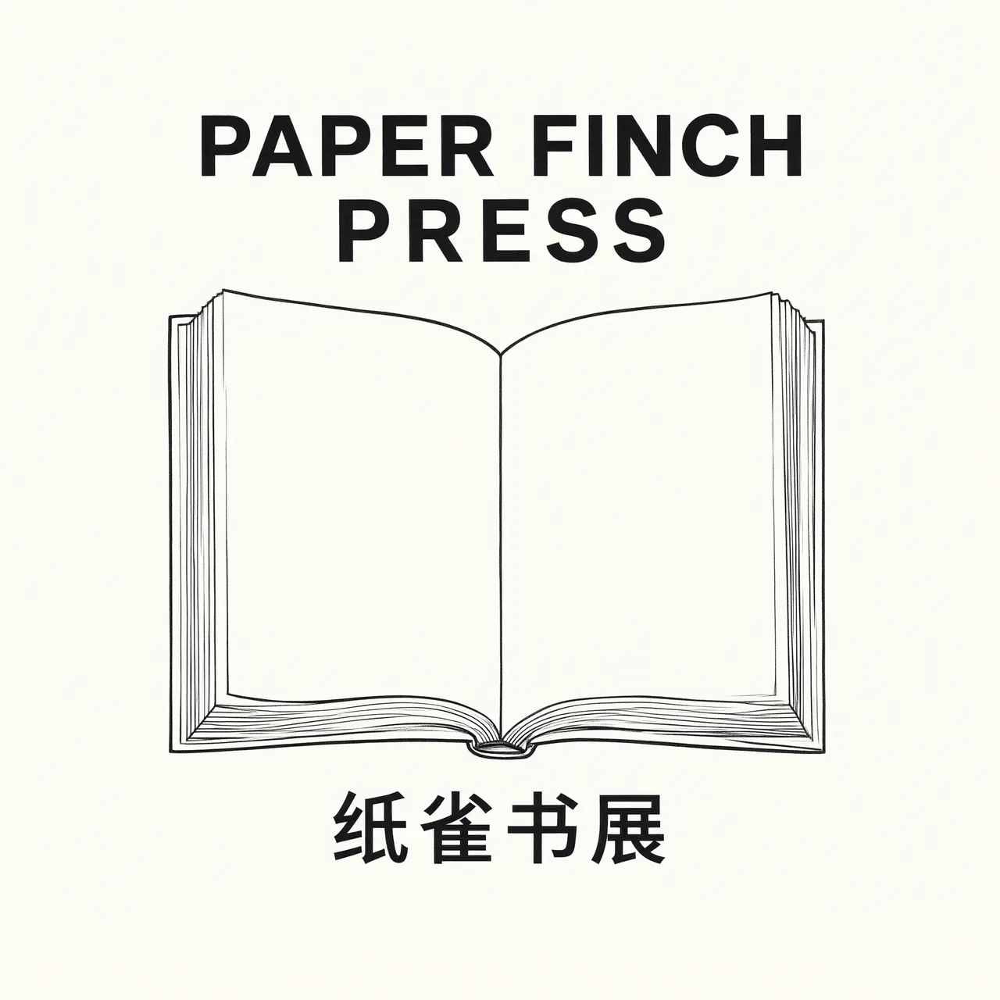</p>

*A square poster with an open-book line drawing and the lines PAPER FINCH, PRESS, and 纸雀书展. AI-generated with Beatra.*

Ask your agent:

```text
Use Qwen Image 3.0 to make a square off-white poster with a line drawing of an open book. The only text is PAPER FINCH, PRESS, and 纸雀书展.
```

Prompt:

```text
Square book-fair poster, off-white paper, a single black line drawing of an open blank book, lots of margin. Exactly three lines of text, perfectly spelled, and no other letters anywhere. Top line: PAPER FINCH in bold black sans-serif. Middle line, directly under it: PRESS, spelled P-R-E-S-S, the first letter is P. Bottom line: the four Chinese characters 纸雀书展. Do not write DRESS. No logos, no watermark.
```

Qwen Image 3.0 · Text to image · 2K · 1:1

Generated on Beatra · task task_mcp_fde63ad38a445a53a0722db22d76c2c373a98e7c

### 6. Reedbank cafe menu board

A cafe menu board shows Qwen Image 3.0 setting Chinese and English type at three sizes.

<p align="center">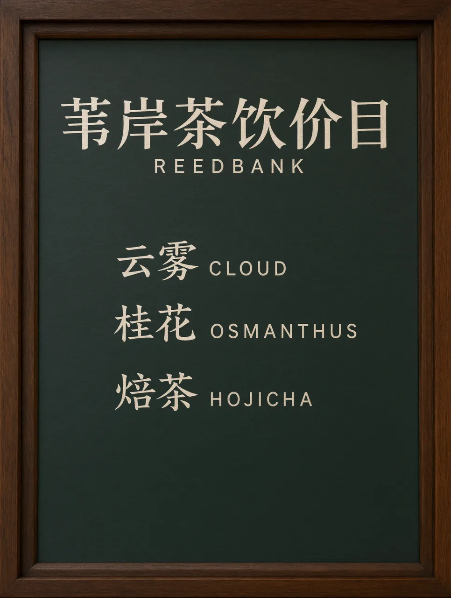</p>

*A slate-green board in a walnut frame, with 苇岸茶饮价目, REEDBANK, and the lines 云雾 CLOUD, 桂花 OSMANTHUS, and 焙茶 HOJICHA. AI-generated with Beatra.*

Ask your agent:

```text
Use Qwen Image 3.0 to make a vertical cafe menu board in a walnut frame. The only text is 苇岸茶饮价目, REEDBANK, 云雾 CLOUD, 桂花 OSMANTHUS, and 焙茶 HOJICHA.
```

Prompt:

```text
Photoreal wooden cafe menu board, dark walnut frame, cream painted lettering on a slate-green board, photographed straight-on, even shop light. Exact text only, perfectly spelled, no extra letters, no prices, no logos, no watermark: large cream serif at the top 苇岸茶饮价目, directly under it in smaller cream sans-serif capitals REEDBANK, then three drink lines in a smaller size with Chinese then English on the same line, 云雾 CLOUD, 桂花 OSMANTHUS, 焙茶 HOJICHA. No other words or numbers.
```

Qwen Image 3.0 · Text to image · 2K · 3:4

Generated on Beatra · task task_mcp_c927b4b70919f32fb511070101565a7937dd38bc

### 7. River Lantern ticket stub

A vertical ticket stub shows Qwen Image 3.0 stacking a Chinese title, an English subtitle, and a date.

<p align="center">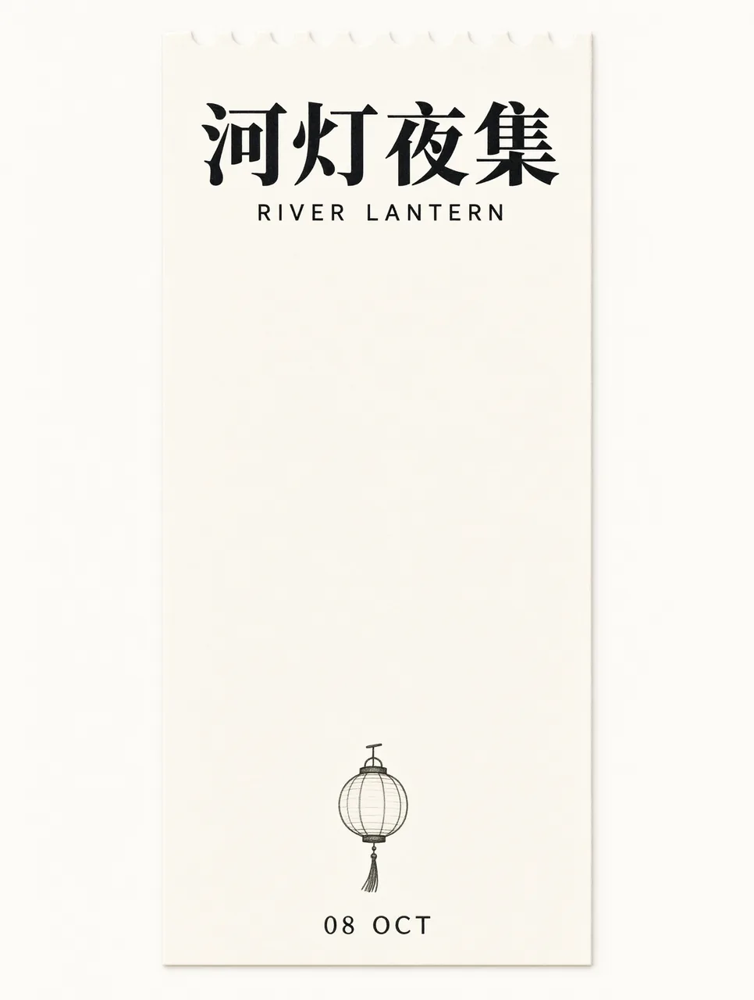</p>

*A cream ticket stub with a paper-lantern drawing and the lines 河灯夜集, RIVER LANTERN, and 08 OCT. AI-generated with Beatra.*

Ask your agent:

```text
Use Qwen Image 3.0 to make a vertical cream ticket stub with one paper-lantern drawing. The only text is 河灯夜集, RIVER LANTERN, and 08 OCT.
```

Prompt:

```text
Vertical event ticket stub, cream paper, perforated top edge, a small simple drawing of one paper lantern, lots of empty margin. Exact text only, perfectly spelled, no extra letters: large bold black serif at the top 河灯夜集, subtitle under it in smaller sans-serif RIVER LANTERN, date at the bottom in small tracking 08 OCT. No other words, numbers, logos, or watermarks.
```

Qwen Image 3.0 · Text to image · 2K · 3:4

Generated on Beatra · task task_mcp_132e3a0b9aad13a093b2f34af8e4fb2127317a70

<a id="ecommerce"></a>

## Product photos and scenes

### 8. Winter evening pour-over

A winter pour-over still life shows the Qwen Image 3.0 edit that changes the season of a product photo.

<p align="center">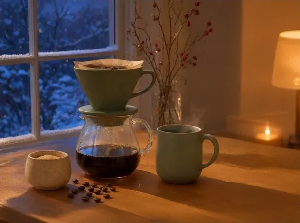</p>

*The same pour-over set, now in a snowy evening by the window. The input photo is also AI-generated with Beatra.*

Ask your agent:

```text
Use Qwen Image 3.0 to edit the pour-over photo: keep the sage-green coffee set where it is, and change the scene to a snowy winter evening.
```

Prompt:

```text
[edit] Change the season and time of day to a cozy winter evening. Keep the ceramic pour-over coffee set exactly as it is: the sage-green dripper with its paper filter and handle on the glass carafe of coffee, the sage-green mug, the speckled cream sugar bowl, the coffee beans, the oak table, and the camera angle and positions of every object. Outside the window it is now dusk with snow falling, snow-covered branches and a deep blue evening sky; a little snow rests on the window frame. Replace the summer sunlight with warm indoor lamplight from the right and soft candlelight, gentle warm glow on the ceramics, a thin wisp of steam rising from the mug, and swap the green leaves in the glass jar for a few bare winter twigs with small red berries. Warm amber and deep blue color contrast, photoreal lifestyle photography. No people, no text, no logos.
```

Qwen Image 3.0 · Image editing · 616×458

Generated on Beatra · task task_mcp_9e6bd9541f728564e941e08748f6a7da4ef5dacc

### 9. Siltjar hot-sauce bottle

A studio bottle shot shows Qwen Image 3.0 rendering a fictional product and a one-word label.

<p align="center">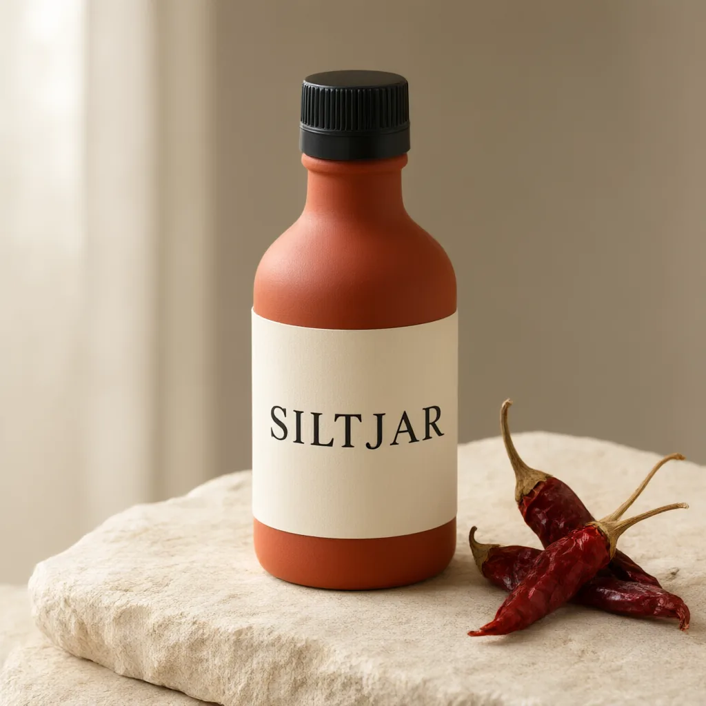</p>

*A clay-red bottle with a black cap and a cream label that reads SILTJAR. AI-generated with Beatra.*

Ask your agent:

```text
Use Qwen Image 3.0 to make a product photo of one fictional hot-sauce bottle on limestone. The cream label says only SILTJAR.
```

Prompt:

```text
Photoreal studio product photo of one fictional hot-sauce bottle on a pale limestone slab. The bottle is short, matte clay-red ceramic with a black screw cap and a plain cream label. The label carries only the exact word SILTJAR in black serif, perfectly spelled, once. Soft window light from the left, a few dried chili peppers beside the bottle, shallow depth of field, no hands, no other text, no logos, no watermark.
```

Qwen Image 3.0 · Text to image · 1K · 1:1

Generated on Beatra · task task_mcp_311c592f739e31aa31e2d5bed3b42850b7a6ad4b

### 10. Oatmeal canvas sneaker

A catalog sneaker shot shows Qwen Image 3.0 making a clean product photo with no logo.

<p align="center">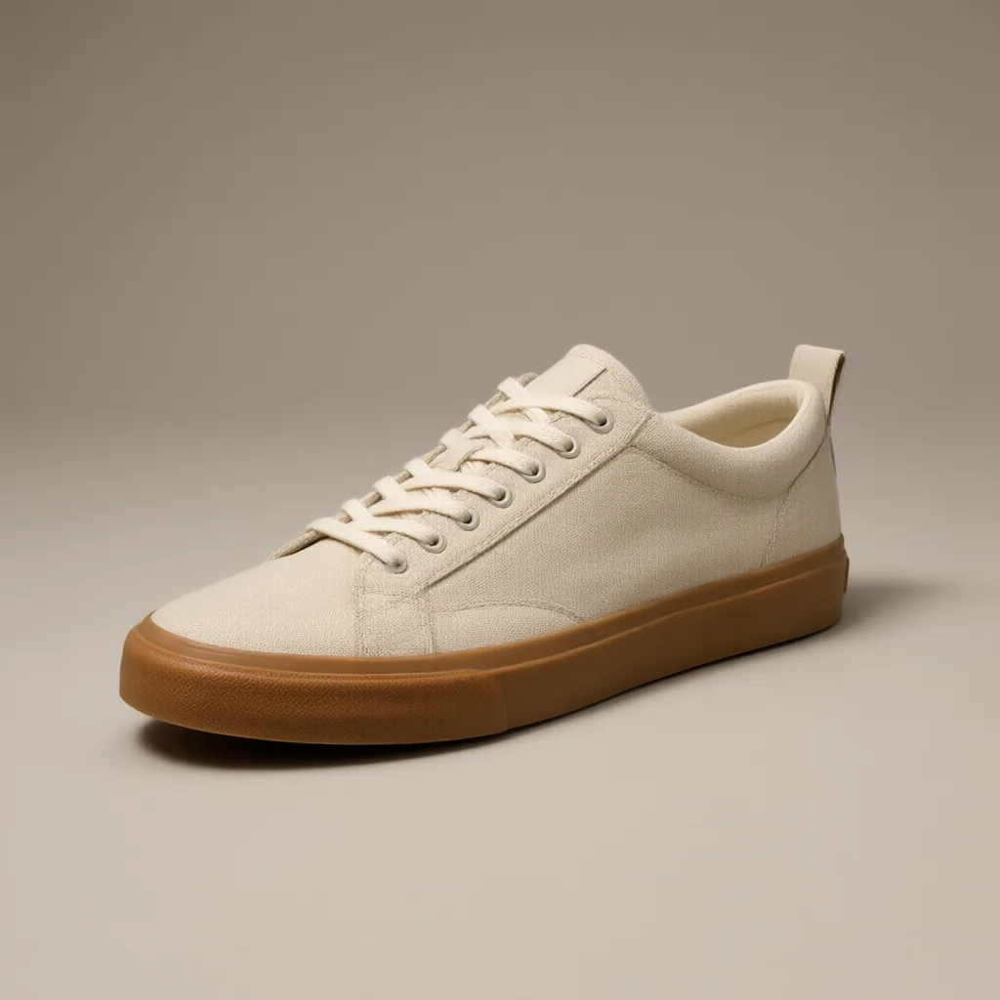</p>

*One oatmeal low-top sneaker with a gum sole on a warm-grey background. AI-generated with Beatra.*

Ask your agent:

```text
Use Qwen Image 3.0 to make a product photo of one fictional low-top sneaker, oatmeal canvas and a gum sole, on a warm-grey background. No logo and no text.
```

Prompt:

```text
Photoreal product photo of one fictional low-top sneaker, three-quarter view, on a seamless warm-grey cyclorama. The shoe is oatmeal canvas with a gum rubber sole, cream laces, and a small blank heel tab. No wordmark, no logo, no text anywhere. Soft overhead daylight, crisp but gentle shadow, commercial catalog lighting. No people, no hands, no watermark.
```

Qwen Image 3.0 · Text to image · 1K · 1:1

Generated on Beatra · task task_mcp_41fa7eafe76d178f9fdac8d5420e62dd78587068

### 11. Brass candle tin on oak

A tabletop still life of a candle shows Qwen Image 3.0 keeping a simple unlabeled product shape.

<p align="center">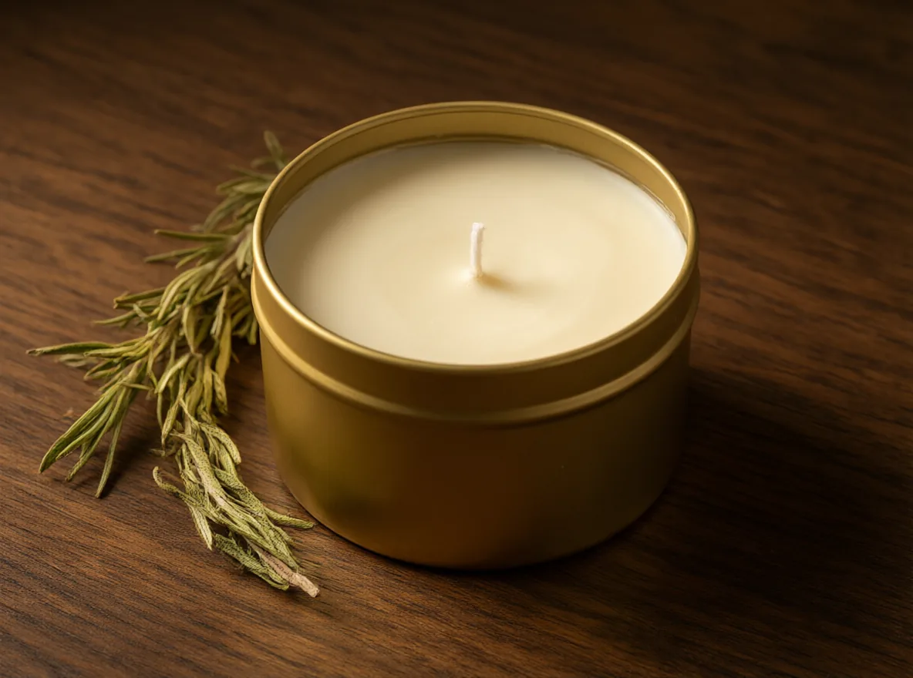</p>

*A low brass tin of cream wax and a rosemary sprig on dark oak. AI-generated with Beatra.*

Ask your agent:

```text
Use Qwen Image 3.0 to make a tabletop photo of a fictional brass candle tin with an unlit wick and a sprig of rosemary on dark oak. No label and no letters.
```

Prompt:

```text
Photoreal tabletop photo of a fictional candle: a low brass tin of cream soy wax with one unlit cotton wick, sitting on dark oak. Beside it, a sprig of dried rosemary. The tin has no label and no letters. Warm side light, shallow depth of field, catalog still life. No people, no hands, no logos, no watermark.
```

Qwen Image 3.0 · Text to image · 1K · 4:3

Generated on Beatra · task task_mcp_341f4873b3d3cb190bc4a82588df5b1db8bc2312

### 12. Oat linen tote and a pear

A lifestyle tote photo shows Qwen Image 3.0 placing one product in a quiet room.

<p align="center">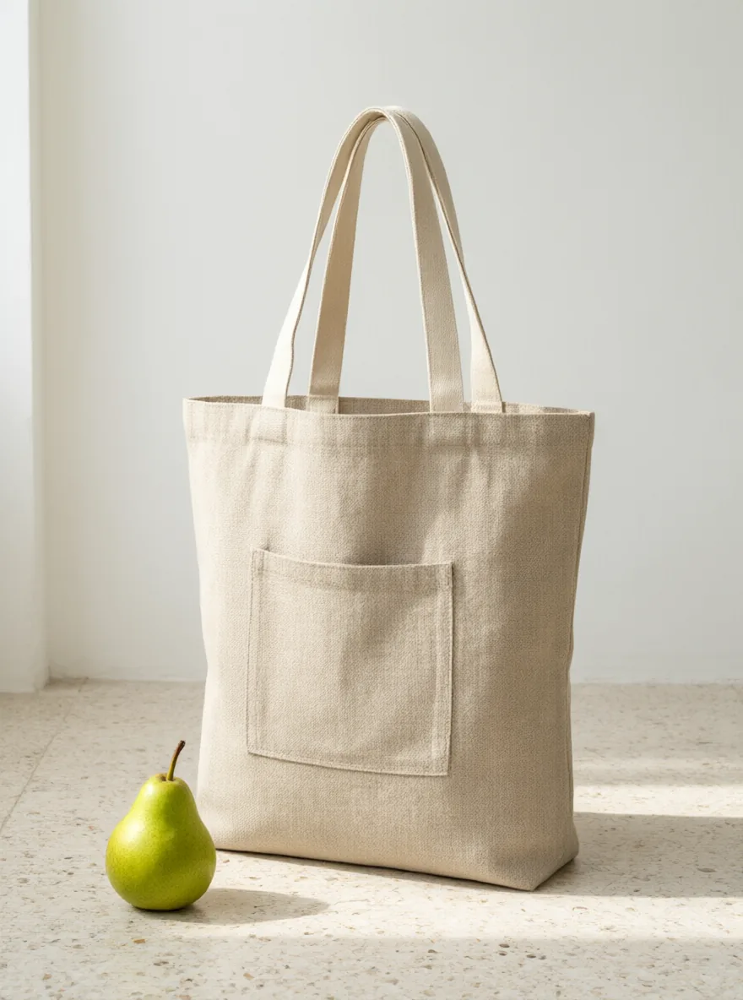</p>

*An undyed linen tote stands on pale terrazzo, with a green pear beside it. AI-generated with Beatra.*

Ask your agent:

```text
Use Qwen Image 3.0 to make a lifestyle photo of a fictional oat-linen tote standing on pale terrazzo against a white wall, with one green pear beside it. No print and no text.
```

Prompt:

```text
Photoreal lifestyle product photo of a fictional heavy linen tote bag standing upright on a pale terrazzo floor against a white wall. The bag is undyed oat linen with two short cotton handles and a small rectangular patch pocket. No print, no letters, no logo. Morning light from the left, a single green pear on the floor beside the bag. No people, no hands, no watermark.
```

Qwen Image 3.0 · Text to image · 1K · 3:4

Generated on Beatra · task task_mcp_62d074025fb6e065bd7b0dd4d9aa80f40e72ca97

### 13. SOLUM serum bottle on wet stone

A serum bottle on wet stone shows Qwen Image 3.0 rendering a fictional product with the label SOLUM.

<p align="center">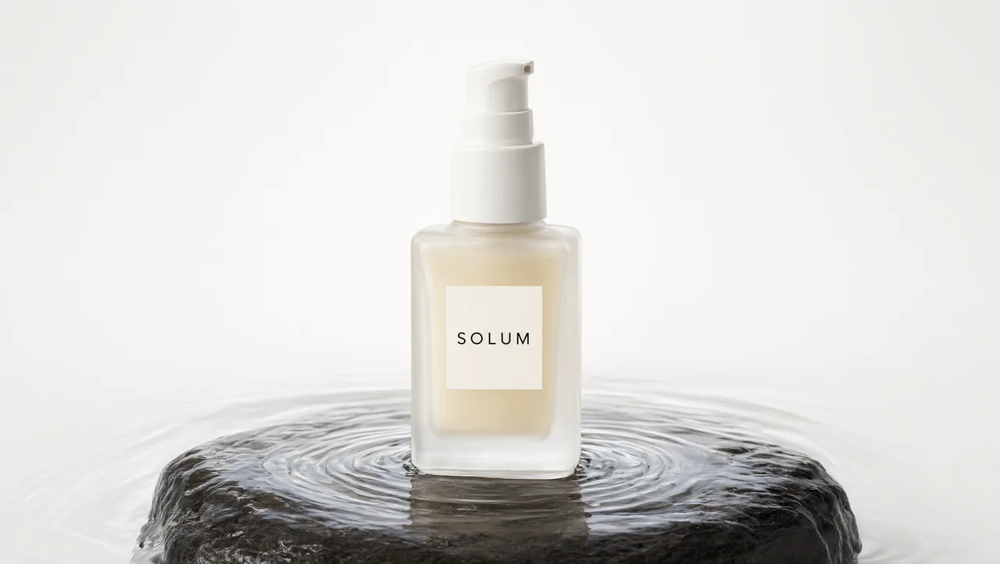</p>

*A frosted-glass serum bottle with a white pump and the label SOLUM stands on wet dark stone. AI-generated with Beatra.*

Ask your agent:

```text
Use Qwen Image 3.0 to photograph one fictional frosted-glass serum bottle with a white pump, standing in water on dark wet stone. The label says only SOLUM, with no hyphen.
```

Prompt:

```text
Photoreal commercial studio product photo of one fictional frosted-glass serum bottle, square shoulders, white pump, standing in a shallow pool of clear water on dark wet stone, gentle circular ripples around the base, soft high-key beauty lighting, generous empty margin on all four sides, subject centered. A small cream square label on the bottle shows only the single word SOLUM in black sans-serif capitals as five letters together, no hyphen, no space, no extra marks, and no other letters. No extra bottles, no hands, no logos, no watermark.
```

Qwen Image 3.0 · Text to image · 2K · 16:9

Generated on Beatra · task task_mcp_747899488daf1c608e01a3103a86f767cebd0a01

### 14. Sage headphones on limestone

A catalog photo of headphones shows Qwen Image 3.0 making a product photo with no logo.

<p align="center">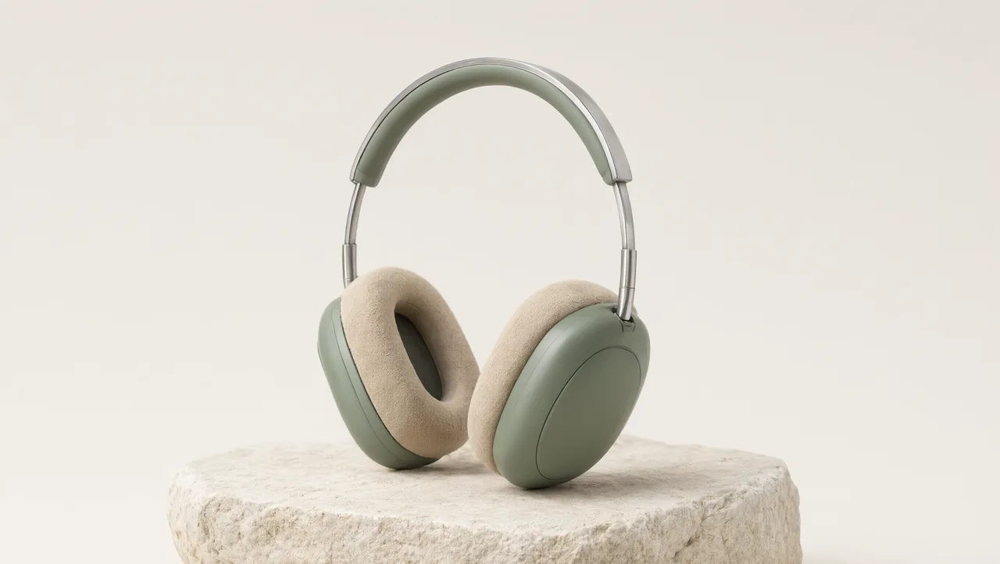</p>

*Sage over-ear headphones with a steel headband and oat suede pads sit on a limestone slab. AI-generated with Beatra.*

Ask your agent:

```text
Use Qwen Image 3.0 to photograph one fictional pair of sage over-ear headphones with a steel headband and oat suede pads, on a pale limestone slab. No logo and no text.
```

Prompt:

```text
Photoreal catalog photo of one fictional pair of closed-back over-ear headphones, matte sage ear cups, a thin brushed-steel headband, oat suede ear pads, no logo and no text anywhere on the product. Three-quarter view, centered on a pale limestone slab, soft studio light, generous empty margin on all four sides. No people, no hands, no extra objects, no watermark.
```

Qwen Image 3.0 · Text to image · 2K · 16:9

Generated on Beatra · task task_mcp_30b180b44416554aedc800ae7ea54ded5091b344

<a id="editing"></a>

## Edits and backgrounds

### 15. Siltjar bottle, new counter

A before-and-after shows Qwen Image 3.0 swapping the bottle's counter while keeping the SILTJAR label.

<p align="center">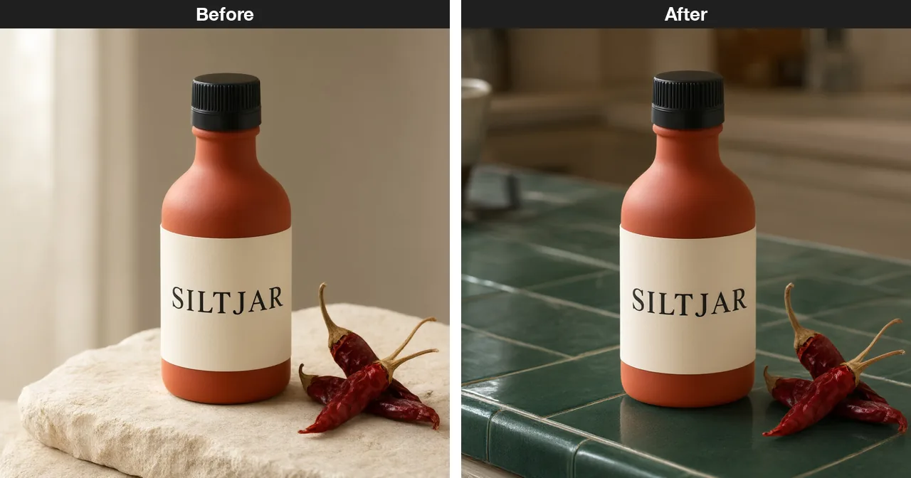</p>

*Left, the bottle on limestone. Right, the same bottle on a dark green tile counter. The input photo is also AI-generated with Beatra.*

Ask your agent:

```text
Use Qwen Image 3.0 to edit the Siltjar bottle photo: keep the bottle, cap, chilies, and the SILTJAR label, and replace the counter with dark green tile.
```

Prompt:

```text
Keep the clay-red ceramic bottle, its black cap, the dried chilies, and the cream label exactly as they are. The label must still read SILTJAR, spelled S-I-L-T-J-A-R, and no other letters. Replace the limestone slab and the beige wall with a dark green glazed-tile counter and a softly blurred kitchen. Do not change the bottle shape. No extra text, no logos, no watermark.
```

Qwen Image 3.0 · Image editing · 1K · 1:1

Generated on Beatra · task task_mcp_311c592f739e31aa31e2d5bed3b42850b7a6ad4b, task_mcp_f727724c879a642a71c11f8101a5ad523d00618d

### 16. Sneaker upper turned indigo

A before-and-after shows Qwen Image 3.0 recoloring only the sneaker upper.

<p align="center">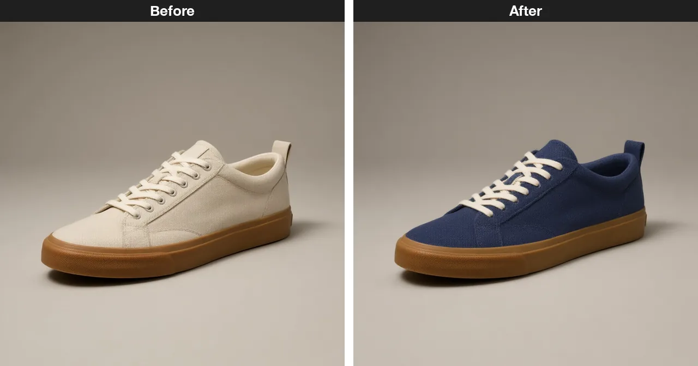</p>

*Left, the oatmeal sneaker. Right, the same shoe with a deep indigo upper. The input photo is also AI-generated with Beatra.*

Ask your agent:

```text
Use Qwen Image 3.0 to edit the oatmeal sneaker photo: keep the angle, gum sole, laces, and blank heel tab, and change only the canvas upper to deep indigo.
```

Prompt:

```text
Keep the same low-top sneaker, the same three-quarter angle, the gum rubber sole, the cream laces, and the blank heel tab. Change only the canvas upper from oatmeal to deep indigo. Do not add text, a logo, a wordmark, or a watermark. No people, no hands.
```

Qwen Image 3.0 · Image editing · 1K · 1:1

Generated on Beatra · task task_mcp_41fa7eafe76d178f9fdac8d5420e62dd78587068, task_mcp_bb1110e3cbe7370acc461410a3b7c9274a011e13

### 17. Tote moved to a rainy door

A before-and-after shows Qwen Image 3.0 moving the same tote from a white room to a rainy doorway.

<p align="center">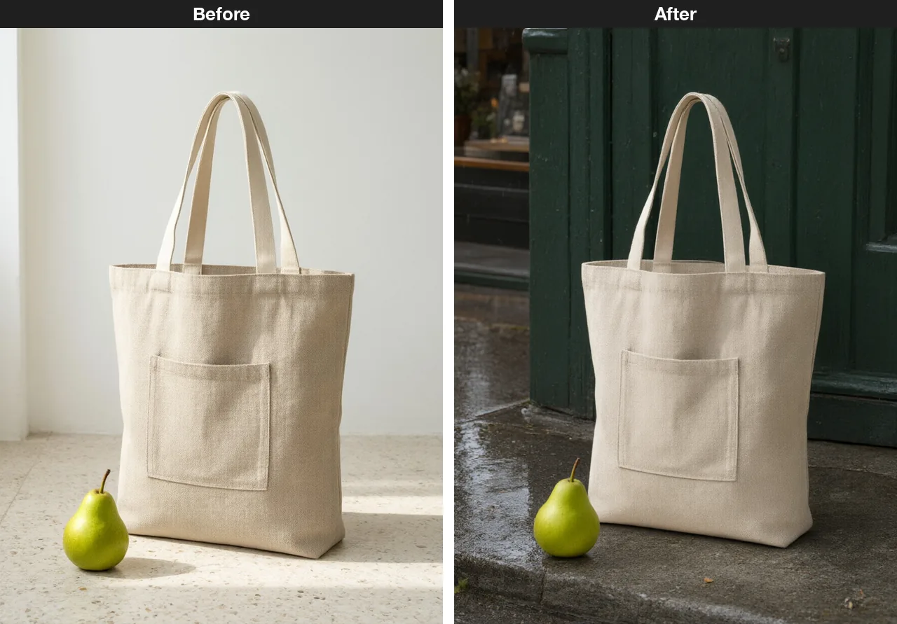</p>

*Left, the tote in a white room. Right, the same tote and pear in a rainy doorway. The input photo is also AI-generated with Beatra.*

Ask your agent:

```text
Use Qwen Image 3.0 to edit the oat-linen tote photo: keep the bag, the pocket, the handles, and the pear, and move them to a rainy shop doorway with a dark green door.
```

Prompt:

```text
Keep the undyed oat linen tote, its patch pocket, its two short handles, and the green pear. Replace the white wall and the terrazzo floor with a rainy shop doorway: wet grey stone under the bag and a dark green wooden door behind it. Overcast daylight. No text, no logo, no watermark, no people, no hands.
```

Qwen Image 3.0 · Image editing · 1K · 3:4

Generated on Beatra · task task_mcp_62d074025fb6e065bd7b0dd4d9aa80f40e72ca97, task_mcp_1cf17a60d29c226d916229738e6b7dff99576ed7

### 18. Desk with the cup and pens removed

A before-and-after shows Qwen Image 3.0 removing the cup and the pens from a desk photo.

<p align="center">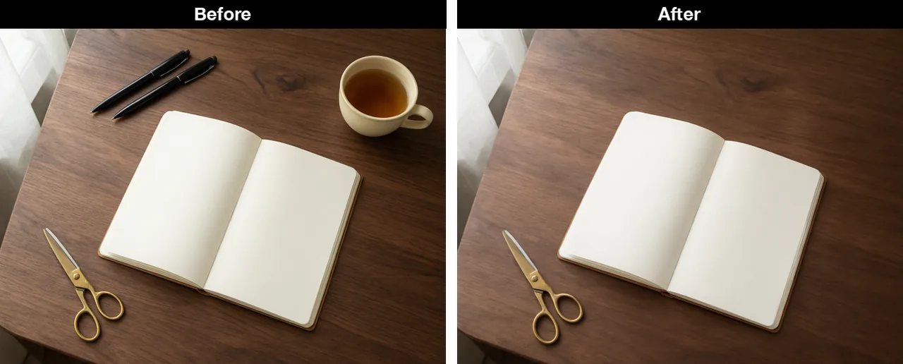</p>

*Left, a walnut desk with an open notebook, brass scissors, a cream cup, and two black pens. Right, the cup and pens are gone, and the notebook and scissors remain. The input photo is also AI-generated with Beatra.*

Ask your agent:

```text
Use Qwen Image 3.0 to edit this desk photo: remove the cream cup and both black pens. Keep the walnut desk, the open notebook, the brass scissors, and the camera angle.
```

Prompt:

```text
Keep the walnut desk, the open blank notebook, the brass scissors, the window light, and the same camera angle. Remove the cream ceramic cup and both black pens completely. Do not add new objects. No text, no logos, no watermark, no hands.
```

Qwen Image 3.0 · Image editing · 2K · 4:3

Generated on Beatra · task task_mcp_2e17ff31a1137a5896558ca57a247d1bdabf6198, task_mcp_e8eff740f4302717e414d1361b4f3faa077dab56

### 19. Lane from noon to a thin-snow evening

A before-and-after shows Qwen Image 3.0 turning a summer lane into an evening with thin snow, while the buildings stay.

<p align="center">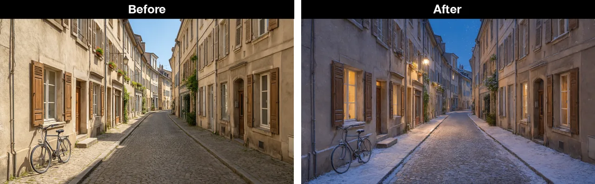</p>

*Left, the lane at a bright summer noon. Right, the same lane in the evening, with thin snow along the roadside and on the sidewalk, lit windows and a street lamp, and green leaves remaining in the window boxes. The input photo is also AI-generated with Beatra.*

Ask your agent:

```text
Use Qwen Image 3.0 to edit this lane photo: keep the buildings, shutters, doors, bicycle, and camera. Change the time to evening, with thin snow along the roadside and on the sidewalk, and lit windows and street lamps.
```

Prompt:

```text
Keep the exact same cobblestone lane, the same plaster buildings, shutters, doors, bicycle, and camera position. Change only the season and time of day to a snowy evening: blue hour, warm window light, a light covering of snow on the street and ledges, falling snow. No people, no cars, no readable signs, no letters, no logos, no watermark.
```

Qwen Image 3.0 · Image editing · 2K · 16:9

Generated on Beatra · task task_mcp_7b7da46f37b24ab2619dc76ac34abddffdd2abc7, task_mcp_a36f684023317a21916a2df525593b22e69b611c

### 20. Shop sign changes to 南窗纸店

A before-and-after shows Qwen Image 3.0 changing the four characters on a shop sign.

<p align="center">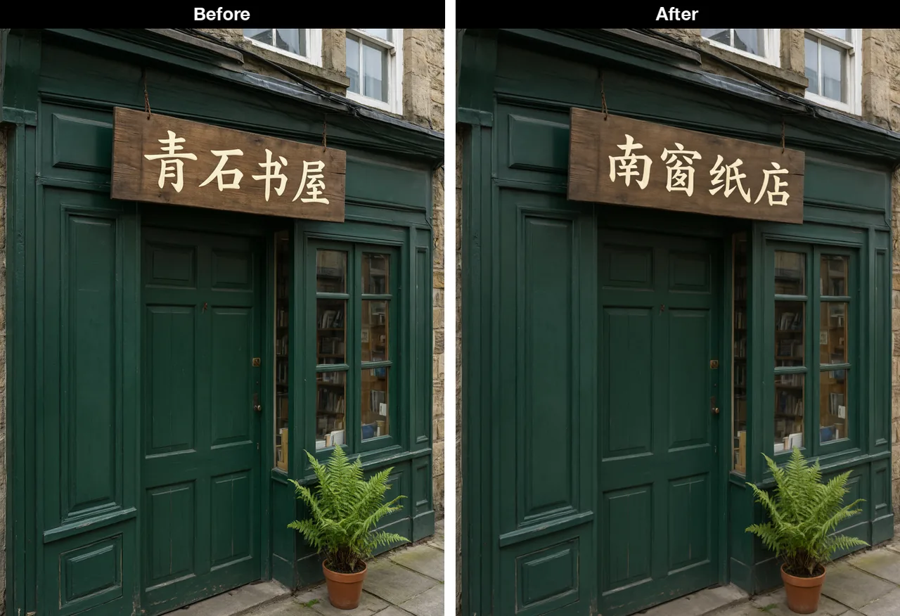</p>

*Left, the hanging sign reads 青石书屋. Right, the same storefront with the sign changed to 南窗纸店. The door, the windows, and the potted fern stay. The input photo is also AI-generated with Beatra.*

Ask your agent:

```text
Use Qwen Image 3.0 to edit this storefront: change the four characters on the sign from 青石书屋 to 南窗纸店. Keep the door, the windows, the potted fern, and the camera.
```

Prompt:

```text
Keep the dark green wooden storefront, the hanging wooden sign shape, the closed door, the potted fern, and the same camera. Change only the four cream characters on the sign from 青石书屋 to exactly 南窗纸店, perfectly spelled, and no other letters. No people, no logos, no watermark, no extra text.
```

Qwen Image 3.0 · Image editing · 2K · 3:4

Generated on Beatra · task task_mcp_047d4b47b255ce306027120018abdd0150ad19af, task_mcp_f99ea4c0f8f6408eb3c78d66ec27e7afcc0174e9

<a id="multi-reference"></a>

## Several references, one picture

### 21. Sauce bottle beside the candle

One still life shows Qwen Image 3.0 combining the sauce bottle and the candle from two reference photos.

<p align="center">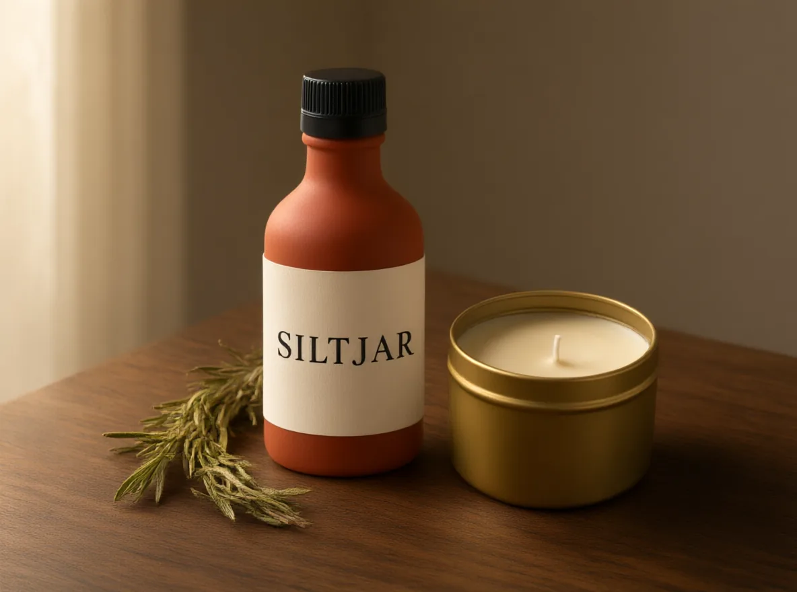</p>

*The clay-red bottle and the brass candle tin share one oak table. AI-generated with Beatra.*

Ask your agent:

```text
Use Qwen Image 3.0 with the Siltjar bottle photo and the brass candle photo. Put both on a dark oak table and keep the SILTJAR label as it is.
```

Prompt:

```text
One catalog still life on a dark oak table in warm side light. Place the hot-sauce bottle from the first image beside the brass candle tin from the second image. Keep the bottle's clay-red body, black cap, and the label spelling SILTJAR exactly. Keep the candle's low brass tin and single unlit wick. No other text, no logos, no watermark, no hands.
```

Qwen Image 3.0 · Image to image · 1K · 4:3

Generated on Beatra · task task_mcp_0fefd99194c4683cedb0377d60ab5d3d3d473b03

### 22. Raincoat fox at the bakery

One illustration shows Qwen Image 3.0 placing the raincoat fox in front of the bakery from a second reference.

<p align="center">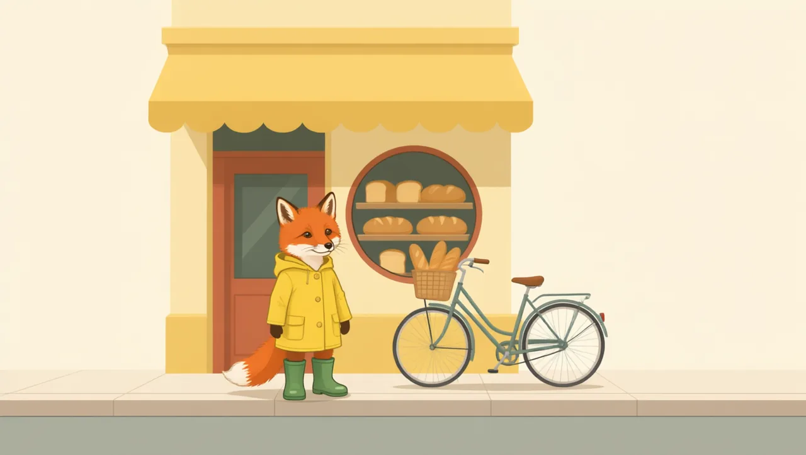</p>

*A red fox in a yellow raincoat stands in front of a bakery with a yellow awning. AI-generated with Beatra.*

Ask your agent:

```text
Use Qwen Image 3.0 with the raincoat-fox drawing and the bakery drawing. Put the fox on the sidewalk in front of that bakery, and keep the yellow awning and the bicycle.
```

Prompt:

```text
A flat editorial illustration. Place the red fox in the yellow raincoat and green boots from the first image on the sidewalk in front of the bakery from the second image. Keep the fox's coat, boots, and face recognizable. Keep the bakery's butter-yellow awning, round window of loaves, and the bicycle. No text, no letters, no logos, no watermark.
```

Qwen Image 3.0 · Image to image · 1K · 16:9

Generated on Beatra · task task_mcp_7957b46f4d4f13057b8c97786dd8a3382aeab804

### 23. Sneaker and tote in one room

One catalog photo shows Qwen Image 3.0 putting the sneaker and the tote from two references into one scene.

<p align="center">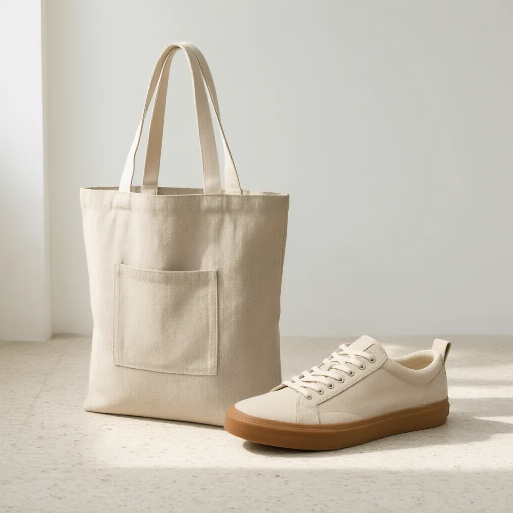</p>

*An oatmeal sneaker and an oat-linen tote sit together on pale terrazzo. AI-generated with Beatra.*

Ask your agent:

```text
Use Qwen Image 3.0 with the oatmeal sneaker photo and the oat-linen tote photo. Place both on pale terrazzo against a white wall.
```

Prompt:

```text
A lifestyle catalog photo on a pale terrazzo floor against a plain white wall, morning light from the left. Place the oatmeal sneaker from the first image next to the oat linen tote from the second image. Keep the shoe's gum sole, cream laces, and blank heel tab. Keep the tote's patch pocket and two handles. No text, no logos, no watermark, no people, no hands.
```

Qwen Image 3.0 · Image to image · 1K · 1:1

Generated on Beatra · task task_mcp_d02521534c3ce35bd12feb25516421ec17716239

### 24. Woman in the rust overcoat

A studio portrait shows Qwen Image 3.0 dressing the woman from one reference in the coat from another.

<p align="center">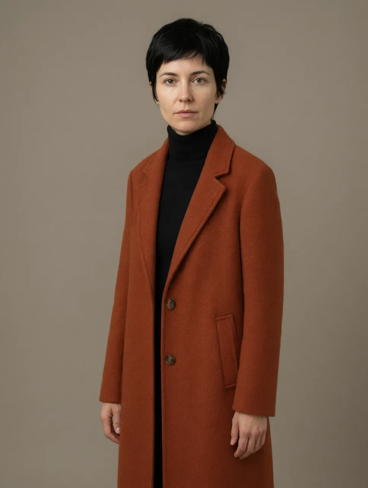</p>

*A woman with short black hair and a black turtleneck wears the rust wool overcoat. The reference photos are also AI-generated with Beatra.*

Ask your agent:

```text
Use Qwen Image 3.0 with the portrait and the rust overcoat photo. Put that coat on the woman, unbuttoned, and keep her face, short black hair, and black turtleneck.
```

Prompt:

```text
A photoreal studio portrait of the woman from the first image wearing the rust wool overcoat from the second image. Keep her face, short black hair, and black turtleneck recognizable. The coat is on her, unbuttoned, same rust color and lapels. Plain warm-grey studio, even soft light, three-quarter view, hands visible and anatomically correct. No text, no logos, no watermark.
```

Qwen Image 3.0 · Image to image · 2K · 3:4

Generated on Beatra · task task_mcp_22573ba199b5621c53651ace43f0ccfef57b6ee1, task_mcp_c42d709ecb959be103adb8c75ecf40acccf04181, task_mcp_f7231ab9c8f991dfab2029c068d5a0d780610b0c

### 25. Black kettle on the kitchen counter

A kitchen counter shows Qwen Image 3.0 placing the kettle from one reference onto the counter from another.

<p align="center">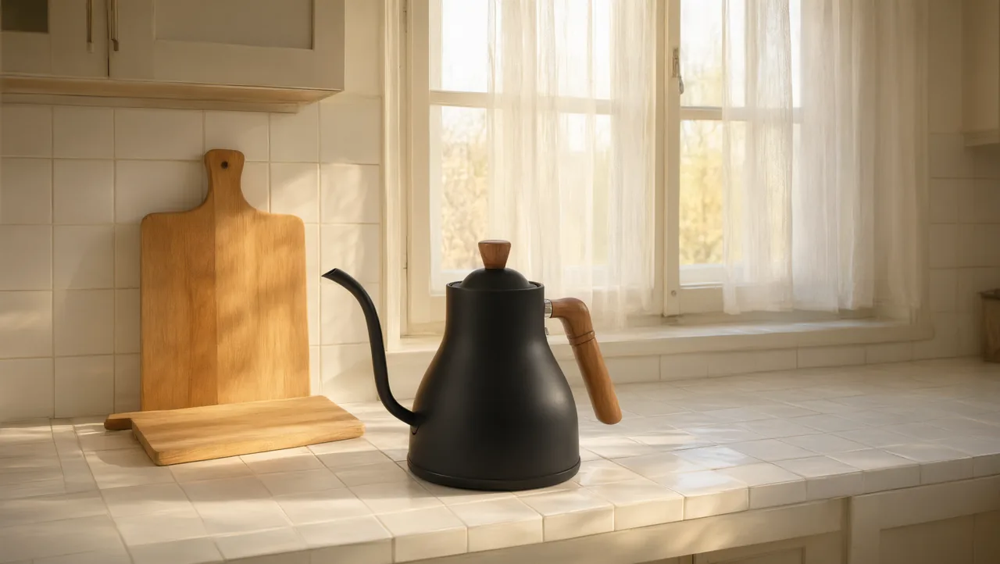</p>

*The matte-black gooseneck kettle sits on the sunlit white-tile counter, beside a wood cutting board. The reference photos are also AI-generated with Beatra.*

Ask your agent:

```text
Use Qwen Image 3.0 with the kettle photo and the kitchen photo. Put the matte-black gooseneck kettle on the white-tile counter near the wood cutting board.
```

Prompt:

```text
Place the matte-black gooseneck kettle from the first image on the sunlit white-tile kitchen counter from the second image, near the wood cutting board. Keep the kettle's round body, long curved spout, and wood handle. Keep the window, sheer curtains, and morning light. No people, no logos, no readable text, no watermark.
```

Qwen Image 3.0 · Image to image · 2K · 16:9

Generated on Beatra · task task_mcp_d362b0190e4253225116f164a93d479113c81f01, task_mcp_b9f89ed177cabe7341189d1e19edfee43a8536a0, task_mcp_1407f1dbee504b8160d8a0fb1f84bd15cea1101d

<a id="illustration"></a>

## Illustration and style

### 26. Flat home-office illustration

A flat desk illustration shows Qwen Image 3.0 Pro drawing a simple editorial scene with no text.

<p align="center">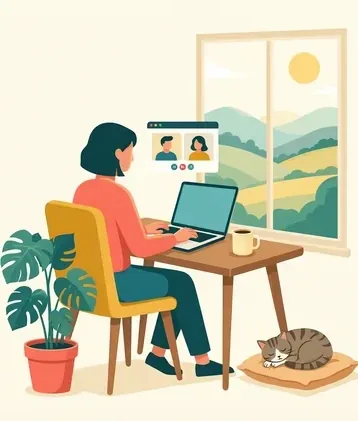</p>

*A flat illustration of a person at a home desk, with a mug, a plant, and a cat. AI-generated with Beatra.*

Ask your agent:

```text
Use Qwen Image 3.0 Pro to draw a flat illustration of a person working at a home desk by a window, with a mug, a monstera, and a sleeping cat. No text.
```

Prompt:

```text
[panel 2] Flat vector illustration for a blog header about remote work. A cozy home workspace seen from a slight side angle: a person with short dark hair sits at a wooden desk by a large window, working on a laptop, a mug of coffee beside it, a leafy potted monstera, a sleeping cat curled on a cushion nearby, and a small video-call window with two simple abstract avatars floating above the laptop. Through the window, soft rolling hills and a morning sun. Clean geometric shapes, flat colors with subtle grain texture, limited palette of warm coral, mustard yellow, teal and cream, no gradients, no outlines on the background, modern editorial illustration style, balanced composition with calm negative space. No text, no letters, no logos.
```

Qwen Image 3.0 Pro · Text to image · 358×421

Generated on Beatra · task task_mcp_38f1a34bf6fc493f7b65440ecef6925365d29b83

### 27. Storm lighthouse, no people

A lighthouse concept frame shows Qwen Image 3.0 Pro painting a cinematic landscape with no people.

<p align="center"></p>

*A white lighthouse on rocks, with waves and a beam through the rain. AI-generated with Beatra.*

Ask your agent:

```text
Use Qwen Image 3.0 Pro to paint a lone white lighthouse on rocks in a dusk storm, with a gold beam through the rain. No people, no boats, no text.
```

Prompt:

```text
[panel 3] Cinematic concept art film still: a lone white stone lighthouse on a jagged rocky headland at dusk during a violent storm. Huge dark waves crash against the rocks and burst into white spray, the lighthouse beam cuts a bright golden shaft through slanting rain and low churning clouds. Deep teal and slate-blue storm sky with a thin band of burning orange sunset light on the horizon, a single warm lit window at the lighthouse base. Low wide-angle camera, dramatic scale, volumetric light, atmospheric haze, high dynamic range, anamorphic film look, rich contrast, highly detailed. No people, no boats, no text.
```

Qwen Image 3.0 Pro · Text to image · 421×421

Generated on Beatra · task task_mcp_af531ac21ea594fd04515e5c14f314ba434cf716

### 28. Flat bakery storefront

A flat bakery storefront shows Qwen Image 3.0 drawing a limited-palette illustration with no text.

<p align="center">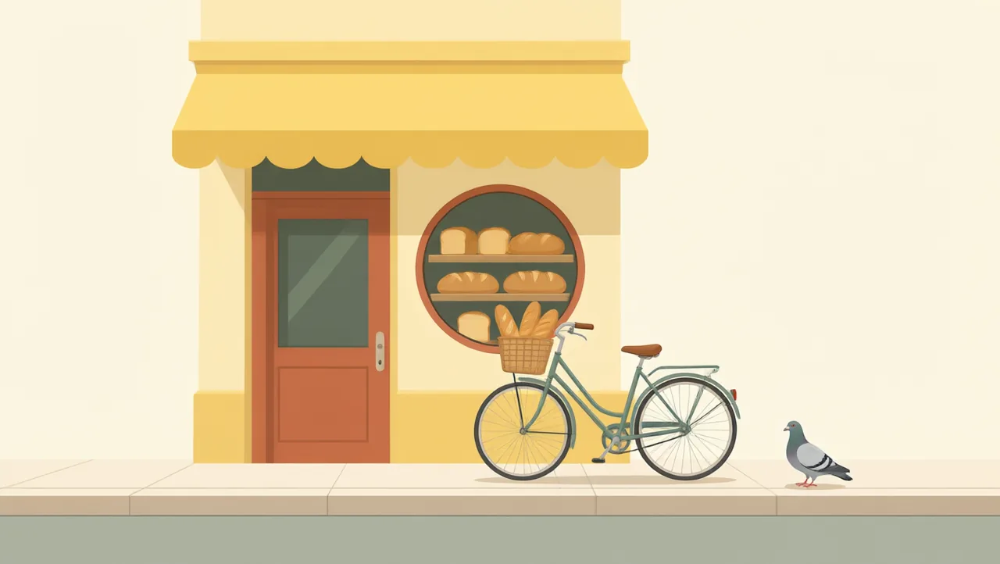</p>

*A small bakery with a yellow awning, a bicycle, and one pigeon. AI-generated with Beatra.*

Ask your agent:

```text
Use Qwen Image 3.0 to draw a flat bakery storefront with a butter-yellow awning, a round window of loaves, a bicycle, and one pigeon. No text.
```

Prompt:

```text
Flat editorial illustration of a tiny fictional bakery storefront on a quiet street at morning. Butter-yellow awning, a round window full of plain loaves, a bicycle with a basket of bread, one pigeon. Limited palette of butter, terracotta, sage, and cream. Clean shapes, no outlines on the sky, no text, no letters, no logos, no watermark.
```

Qwen Image 3.0 · Text to image · 1K · 16:9

Generated on Beatra · task task_mcp_5b98f2ff025529cf8e05e8c226daa12afbfce7a7

### 29. Gouache night train

A gouache night train shows Qwen Image 3.0 painting the landscape in gouache.

<p align="center">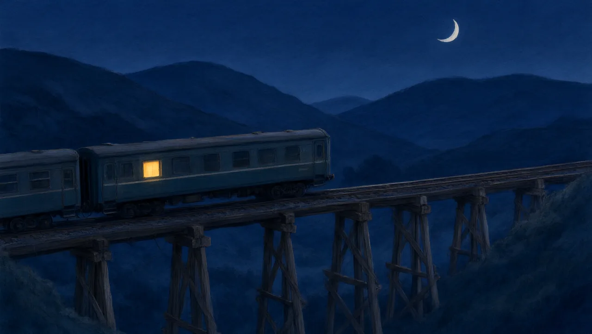</p>

*A short night train on a wooden trestle, with one warm window lit. AI-generated with Beatra.*

Ask your agent:

```text
Use Qwen Image 3.0 to paint a gouache night train crossing a wooden trestle, one lit window, indigo hills, and a thin moon. No people and no text.
```

Prompt:

```text
Gouache illustration of a short fictional night train crossing a wooden trestle, one warm square window lit, deep indigo hills and a thin moon. Visible paper texture, soft brush edges, no people visible, no text, no letters, no logos, no watermark.
```

Qwen Image 3.0 · Text to image · 1K · 16:9

Generated on Beatra · task task_mcp_352beec571cea8b1cdb58f6633f0acb9a6418ff8

### 30. Pencil fox in a raincoat

A colored-pencil fox in a raincoat shows Qwen Image 3.0 drawing an original character.

<p align="center">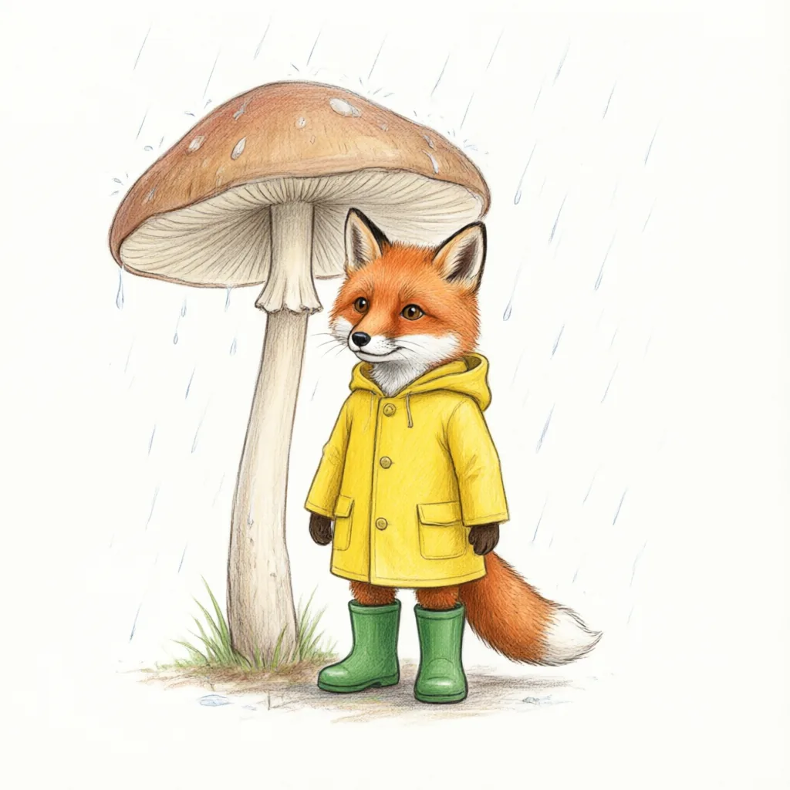</p>

*A red fox in a yellow raincoat and green boots stands under a mushroom. AI-generated with Beatra.*

Ask your agent:

```text
Use Qwen Image 3.0 to draw a colored-pencil picture of an original red fox in a plain yellow raincoat and green boots, under one mushroom. No text.
```

Prompt:

```text
Children's book illustration, soft colored pencil, of an original red fox wearing a plain yellow raincoat and green boots, standing under a single mushroom in light rain. White paper background, no text, no letters, no logos, no watermark. The fox is not a known character.
```

Qwen Image 3.0 · Text to image · 1K · 1:1

Generated on Beatra · task task_mcp_733218bdb6a7c5919f298dc0a4dba9650e049834

### 31. Isometric record-shop interior

An isometric record shop shows Qwen Image 3.0 drawing a limited-palette interior with no readable words.

<p align="center">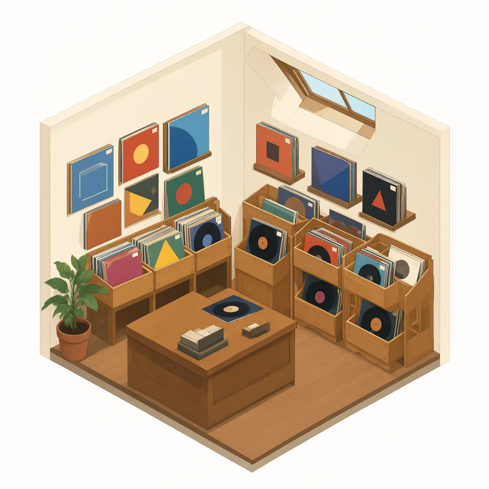</p>

*An isometric record shop with a wood counter, vinyl crates, a plant, and a skylight. The sleeves are color blocks and simple shapes. AI-generated with Beatra.*

Ask your agent:

```text
Use Qwen Image 3.0 to draw an isometric record shop with a wood counter, vinyl crates, one plant, and a skylight. Album sleeves are solid colors or simple shapes. No letters.
```

Prompt:

```text
Isometric illustration of a tiny fictional record-shop interior, limited flat colors. One wooden counter, wooden vinyl crates, a potted plant, a skylight, no people. Every album sleeve is a solid color or a simple geometric shape with no letters, no numbers, no logos, and no readable marks of any kind. Clean vector-like isometric, generous margin.
```

Qwen Image 3.0 · Text to image · 2K · 1:1

Generated on Beatra · task task_mcp_acaac2206d1b6265deae510ba885de52453ad466

<a id="portraits"></a>

## Fictional portraits

### 32. Fictional presenter, head and shoulders

A studio headshot shows Qwen Image 3.0 Pro rendering a fictional presenter with a natural face.

<p align="center"></p>

*A head-and-shoulders portrait of a fictional woman in a sage-green sweater. AI-generated with Beatra.*

Ask your agent:

```text
Use Qwen Image 3.0 Pro to make a head-and-shoulders photo of a fictional woman in her mid-thirties, in a sage-green sweater, looking at the camera with a closed-mouth smile. Plain grey background, no text.
```

Prompt:

```text
Photorealistic head-and-shoulders portrait of a friendly product educator, a woman in her mid-30s, looking directly into the camera with a warm, relaxed closed-mouth smile, as if about to start speaking to viewers. Shoulder-length dark brown hair, natural makeup, a simple sage-green crew-neck knit sweater with no logos or text. Centered framing from mid-chest up with comfortable headroom, both shoulders visible, arms and hands out of frame. Plain seamless warm light-grey studio backdrop with a gentle soft falloff. Soft large key light from the front-left, subtle fill, clean catchlights in both eyes, natural skin texture, symmetric well-formed eyes and ears, sharp focus on the face, shallow depth of field. Shot on an 85mm lens, true-to-life color, calm and trustworthy presenter look. No text, no watermark, no jewelry, no microphone.
```

Qwen Image 3.0 Pro · Text to image · 616×829

Generated on Beatra · task task_mcp_181a7bf4c51b51ae1271bc4d433b8d1fa0b8df4a

### 33. Cafe portrait after an edit

A close portrait shows the Qwen Image 3.0 edit that takes the plastic look off a fictional face.

<p align="center">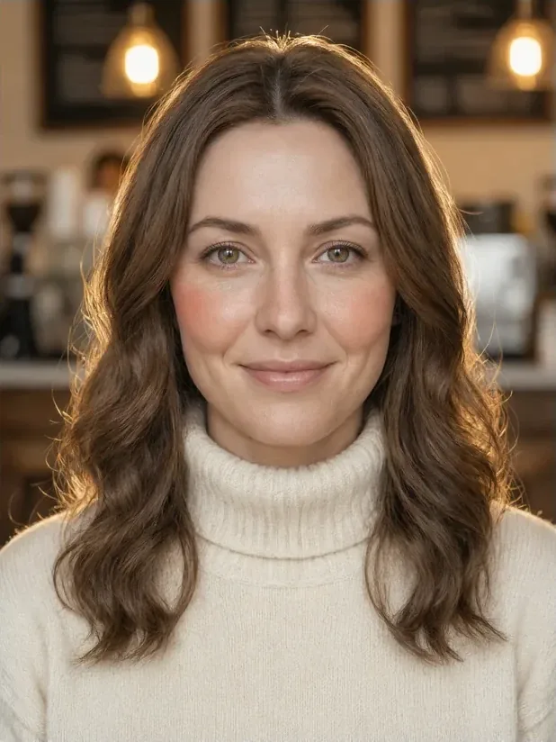</p>

*A close portrait of a fictional woman in a cream turtleneck, in a cafe. The input photo is also AI-generated with Beatra.*

Ask your agent:

```text
Use Qwen Image 3.0 to edit this cafe portrait of a fictional woman: keep her face, chestnut hair, and cream turtleneck, and bring back ordinary skin texture.
```

Prompt:

```text
[after] Reduce the plastic, airbrushed AI look across this portrait so it reads like a real camera photograph. Restore natural skin texture with fine visible pores, subtle fine lines and slight natural unevenness in skin tone; replace the two round orange blush patches with a faint natural flush; tone down the over-saturated orange-pink glow, bloom haze and over-bright rim light to realistic warm cafe lighting with natural color; make the catchlights in the eyes small and natural. Preserve the same woman's identity and facial features, expression and closed-mouth smile, eye color, wavy chestnut hairstyle, cream knit turtleneck sweater, pose, framing, crop, cafe background and lighting direction. Do not add makeup, text or logos.
```

Qwen Image 3.0 · Image editing · 618×824

Generated on Beatra · task task_mcp_36cb6399c5ce443a72f54b7af67ccdb44f0a8509

### 34. Fictional baker, head and shoulders

A bakery portrait shows Qwen Image 3.0 rendering a fictional man's face, eyes, and ears.

<p align="center">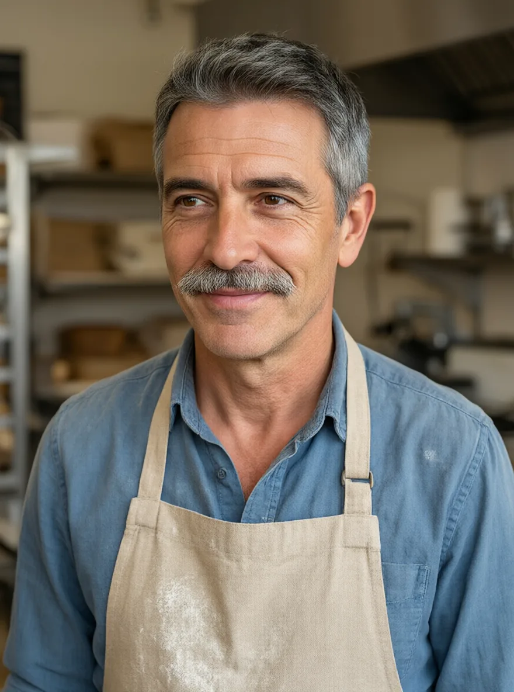</p>

*A fictional man with a grey mustache and a floury apron, in a bakery kitchen. AI-generated with Beatra.*

Ask your agent:

```text
Use Qwen Image 3.0 to make a head-and-shoulders photo of a fictional man in his early fifties, with a grey mustache and a flour-dusted apron, in a bakery kitchen. Hands out of frame, no text.
```

Prompt:

```text
Photoreal head-and-shoulders portrait of a fictional man in his early fifties, short salt-and-pepper hair, a neat grey mustache, warm brown eyes, light crow's feet, wearing a flour-dusted oatmeal linen apron over a faded blue shirt. He looks just off camera with a small closed-mouth smile. Bakery kitchen background softly blurred, morning side light, natural skin texture, both eyes well formed, ears symmetric. Hands out of frame. No text, no logos, no watermark.
```

Qwen Image 3.0 · Text to image · 1K · 3:4

Generated on Beatra · task task_mcp_8de96b9bab4a153e27256b13bbd85807db73f963

### 35. Fictional cyclist on a path

A path portrait shows Qwen Image 3.0 rendering a fictional cyclist and a hand on the bars.

<p align="center">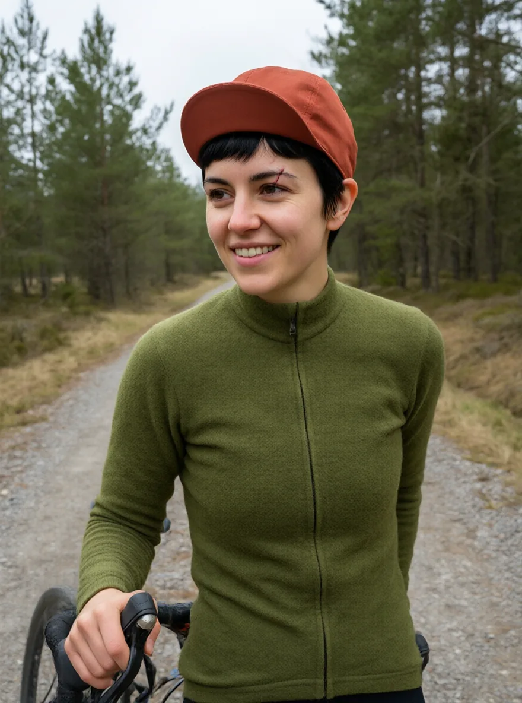</p>

*A fictional woman in a rust cap and a green jersey holds a bicycle bar on a gravel path. AI-generated with Beatra.*

Ask your agent:

```text
Use Qwen Image 3.0 to make a three-quarter photo of a fictional woman in a rust cycling cap and a moss-green jersey, one hand on a bicycle bar, on a gravel path. No logos and no text.
```

Prompt:

```text
Photoreal three-quarter portrait of a fictional woman in her late twenties with a short black crop, a small scar through the left eyebrow, wearing a rust-colored cycling cap and a moss-green wool jersey with no logos. She holds the bicycle handlebar with one hand, five natural fingers, and smiles with teeth unseen. Overcast daylight on a gravel path, pine trees blurred behind. Natural skin, correct eyes and ears. No text, no logos, no watermark.
```

Qwen Image 3.0 · Text to image · 1K · 3:4

Generated on Beatra · task task_mcp_b71e0d1eaf675f21f1d281f69271be4c381d85ce

### 36. Fictional potter by the window

A pottery-studio portrait shows Qwen Image 3.0 rendering a fictional older woman beside a window.

<p align="center">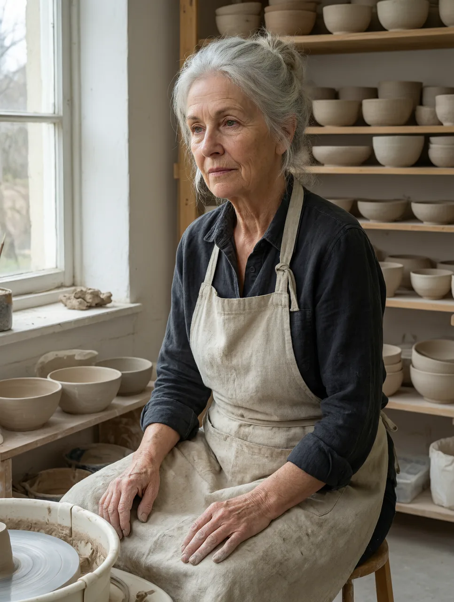</p>

*A fictional older woman with silver hair and a linen apron sits beside a pottery wheel in a studio. AI-generated with Beatra.*

Ask your agent:

```text
Use Qwen Image 3.0 to photograph a fictional older woman with silver hair pinned up, a linen apron over a charcoal shirt, sitting beside a pottery wheel by a studio window. No text.
```

Prompt:

```text
Photoreal three-quarter portrait of a fictional woman in her early seventies, silver hair pinned up, clay-dusted linen apron over a charcoal shirt, sitting beside a pottery wheel near a north-facing studio window, pale daylight, lined natural skin, closed mouth, hands resting on her lap with clay under the nails, anatomically correct. Quiet pottery studio, shelves of unglazed bowls behind her, slightly out of focus. No text, no logos, no watermark.
```

Qwen Image 3.0 · Text to image · 2K · 3:4

Generated on Beatra · task task_mcp_9172f0aa9846821eda365d9ead249487c5c681ea

<a id="infographics"></a>

## Charts and diagrams

### 37. Four-step tea card

A four-step tea card shows Qwen Image 3.0 setting bilingual labels and four icons in a row.

<p align="center">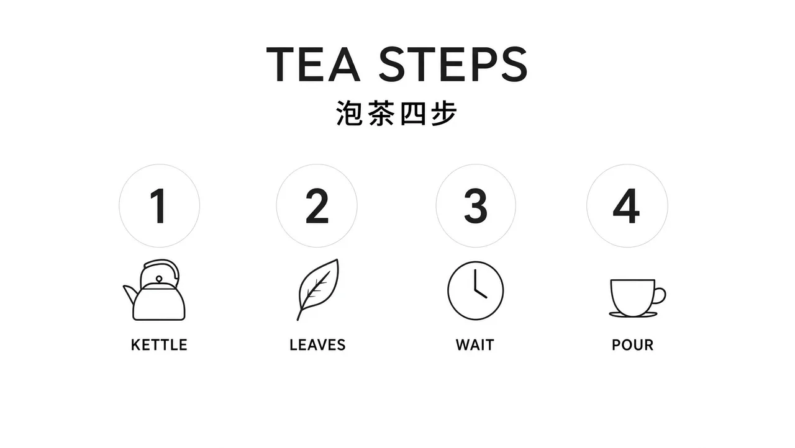</p>

*A wide card titled TEA STEPS, with four numbered icons in a row. AI-generated with Beatra.*

Ask your agent:

```text
Use Qwen Image 3.0 to make a wide infographic titled TEA STEPS, with 泡茶四步 under it, and four steps labeled KETTLE, LEAVES, WAIT, and POUR. No other text.
```

Prompt:

```text
Clean flat infographic on white, wide layout, lots of margin. Title exactly TEA STEPS in black sans-serif. Under it the Chinese line 泡茶四步 exactly. Four circles in a row containing only the digits 1 2 3 4, with the labels KETTLE, LEAVES, WAIT, POUR under them, each label one word, perfectly spelled. Simple line icons of a kettle, a leaf, a clock, and a cup. No other text, no logos, no watermark.
```

Qwen Image 3.0 · Text to image · 2K · 16:9

Generated on Beatra · task task_mcp_1f837487611da4da304c2d0a851e9b023a23562e

### 38. Weekly cups bar chart

A five-bar chart shows Qwen Image 3.0 placing exact values and weekday labels.

<p align="center">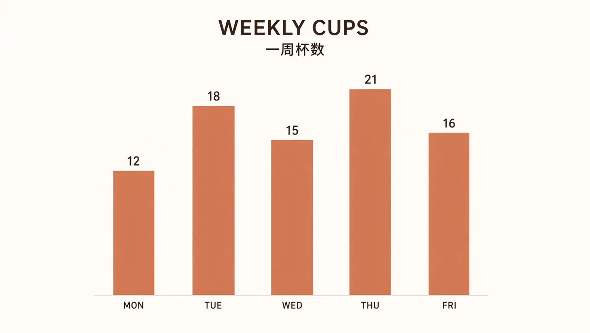</p>

*Five terracotta bars labeled MON through FRI, with the values 12, 18, 15, 21, and 16. AI-generated with Beatra.*

Ask your agent:

```text
Use Qwen Image 3.0 to make a simple bar chart titled WEEKLY CUPS, subtitle 一周杯数, with bars for MON through FRI labeled 12, 18, 15, 21, and 16. No other text.
```

Prompt:

```text
Simple bar chart on warm white. Title exactly WEEKLY CUPS in dark brown sans-serif. Subtitle exactly 一周杯数. Five vertical terracotta bars on a thin baseline, labeled under the axis exactly MON TUE WED THU FRI. Printed above the bars, the exact values 12 18 15 21 16 in that order. No grid, no legend, no other text, no logos, no watermark.
```

Qwen Image 3.0 · Text to image · 2K · 16:9

Generated on Beatra · task task_mcp_63bf1dc9e44ba4061c53a28af507bb91cf582c27

### 39. Three-column fern care card

A three-column care card shows Qwen Image 3.0 keeping the labels and leaving the rest blank.

<p align="center">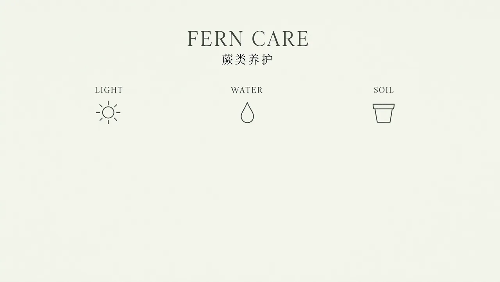</p>

*A pale card titled FERN CARE, with three columns labeled LIGHT, WATER, and SOIL. AI-generated with Beatra.*

Ask your agent:

```text
Use Qwen Image 3.0 to make a three-column card. The only text is FERN CARE, 蕨类养护, LIGHT, WATER, and SOIL, each with one simple icon and blank space under it.
```

Prompt:

```text
Clean three-column care card on pale sage paper, wide layout, lots of empty margin. The only text in the whole image is these five strings, each perfectly spelled, and nothing else: the title FERN CARE, the Chinese line 蕨类养护 directly under the title, and the three column labels LIGHT, WATER, and SOIL. Under LIGHT draw only a simple sun icon. Under WATER draw only a simple drop icon. Under SOIL draw only a simple pot icon. The area under every icon is blank paper. Do not write sentences, captions, descriptions, small print, or placeholder words. No numbers, no logos, no watermark.
```

Qwen Image 3.0 · Text to image · 2K · 16:9

Generated on Beatra · task task_mcp_f2655d171c89420621e41849d0a73120a4d51468

### 40. Pollen Trail schematic map

A trail diagram shows Qwen Image 3.0 drawing a labeled path with no extra words.

<p align="center">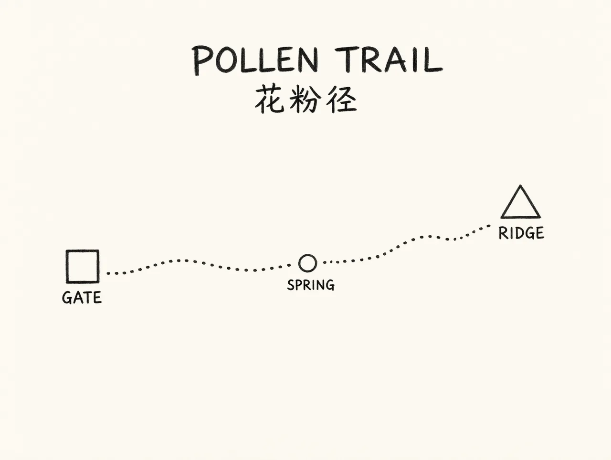</p>

*A cream diagram with a dotted path from GATE to RIDGE and a stop marked SPRING. AI-generated with Beatra.*

Ask your agent:

```text
Use Qwen Image 3.0 to draw a simple trail map titled POLLEN TRAIL, with 花粉径 under it. A dotted path runs from GATE to RIDGE, with SPRING halfway. Those are the only words.
```

Prompt:

```text
Simple schematic trail map on cream paper, not a real place. A single dotted path from a square labeled GATE to a triangle labeled RIDGE, with a small circle labeled SPRING halfway. Title at the top exactly POLLEN TRAIL and the Chinese line 花粉径 under the title. Those five words and the Chinese line are the only text. Flat ink drawing, no logos, no watermark, no compass rose text.
```

Qwen Image 3.0 · Text to image · 2K · 4:3

Generated on Beatra · task task_mcp_f35abee38d9a42f2f62840d1ba7f616e04937ac6

## Why run it on Beatra

- Models in this list: Qwen Image 3.0 Pro, Qwen Image 3.0.
- Free to install. Each render uses credits on your Beatra account, and paid steps run only when you ask for that exact render or approve its card.
- Works with Claude Code, Cursor, Codex, Windsurf, Cline, OpenClaw.

## Contributing

Open an issue to request a case. This list does not accept third-party works.

## License

Prompts and media in this list use CC BY 4.0. Republishing needs attribution and a link back.

## See also

- [Awesome Wan 3.0 Video](https://github.com/beatra-ai/awesome-wan-3-video)
- [AI Image Generator Skill](https://github.com/beatra-ai/ai-image-generator-skill)
- [Beatra Skills](https://github.com/beatra-ai/beatra-skills)
- [beatra.ai](https://beatra.ai/?utm_source=github&utm_medium=cases_list&utm_campaign=awesome-qwen-image-3)
